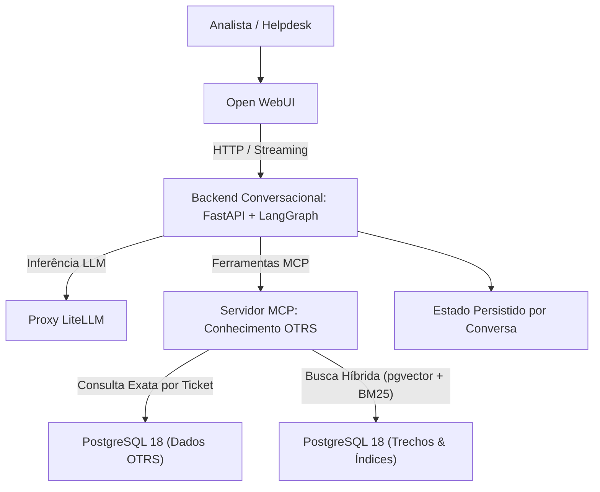

# Chat RAM — Assistente RAG & MCP para Histórico de Tickets (OTRS)

Assistente conversacional baseado em **Agentes de IA, RAG Híbrido e Model Context Protocol (MCP)** projetado para auxiliar analistas de suporte/helpdesk na consulta ao histórico de atendimentos do **OTRS** (mais de 14 milhões de registros migrados), retornando respostas fundamentadas com **evidências auditáveis e rastreabilidade de fontes**.

---

## Arquitetura



### Principais Características
- **Dois fluxos especializados de recuperação:**
  1. **Consulta exata de ticket (`consultar_ticket`)**: Recupera a cronologia completa, fila, status e notas técnicas por número público (`ticket.tn`), preservando fontes exatas.
  2. **Busca híbrida de casos semelhantes (`buscar_casos`)**: Combina busca léxica (BM25/FTS) e semântica (`pgvector`) com fusão de ranking (**RRF - Reciprocal Rank Fusion**) e filtragem por fila.
- **Servidor MCP Dedicado**: Isola a complexidade do schema OTRS e das queries SQL atrás de ferramentas tipadas no protocolo **MCP (`mcp`)**, impedindo execução de SQL arbitrário pelo LLM.
- **Rastreabilidade & Guardrails**: Separa estritamente evidências documentadas nos tickets de sugestões externas, evitando alucinações de números de chamados ou datas.
- **Ambiente 100% Reproduzível com Banco Mock**: Gera dados sintéticos equivalentes ao schema OTRS (`mock/gerar_banco.py`) para desenvolvimento e testes automatizados sem expor dados sensíveis de produção.

---

## Stack Tecnológica

- **Linguagem**: Python 3.11+ (gerenciado com `uv`)
- **API & Orquestração**: FastAPI, Uvicorn, Pydantic v2, LangGraph
- **Protocolo de Ferramentas**: Model Context Protocol (`mcp`)
- **Banco de Dados**: PostgreSQL 18 (`psycopg` v3, `pgvector`)
- **Interface Conversacional**: Open WebUI (com filtro de guardrail customizado)
- **Qualidade & Testes**: Pytest (`pytest-asyncio`, `respx`), Ruff, Mypy (`strict`)

---

## Como Executar

### Pré-requisitos
- Docker & Docker Compose
- Python 3.11+ (opcional para execução de testes no host)

### Comandos Principais (`Makefile`)

```bash
# 1. Copie o arquivo de variáveis de ambiente
cp .env.example .env

# 2. Subir ambiente completo de desenvolvimento (PostgreSQL 18 + Banco Mock + Preparação + API)
make dev

# 3. Subir a interface Open WebUI em http://localhost:3000
make ui

# 4. Instalar/atualizar filtro de guardrail na Open WebUI
make filtro

# 5. Executar a suíte de testes automatizados
make test
```

---

## Documentação Adicional

- [Arquitetura do MVP 0.1](docs/arquitetura-0.1.md)
- [Escopo do MVP 0.1](docs/mvp-0.1.md)
- [Guia de Migração MariaDB $\rightarrow$ PostgreSQL (14,2M registros)](README-migracao.md)
- [Glossário de Domínio](GLOSSARY.md)

---

## Licença

Distribuído sob a licença **Apache 2.0**. Veja [LICENSE](LICENSE) para mais informações.
